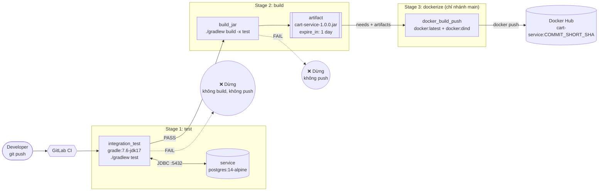
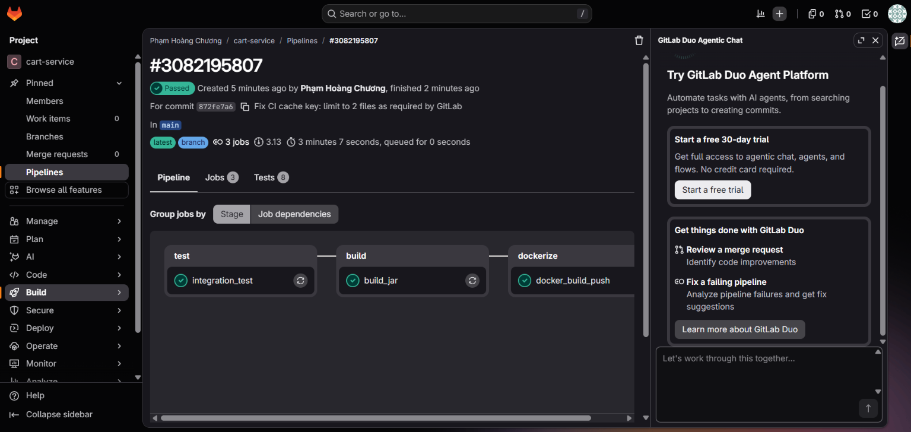

# Cart Service: Pipeline CI/CD cho Microservices (Tiki-clone)

Cart Service quản lý giỏ hàng của dự án **Tiki-clone**, viết bằng **Spring Boot 4 + Gradle + PostgreSQL**.
Repo này chứa pipeline GitLab CI/CD chạy trọn vòng đời của service: **Code → Integration Test (PostgreSQL) → Build Gradle → Package Docker → Push Image**.

> **Nguyên tắc bắt buộc:** không một dòng code nào được đóng gói thành Docker Image nếu chưa vượt qua Integration Test kết nối vào database thật.

---

## 1. Kiến trúc pipeline



Sơ đồ dạng text (trường hợp không hiển thị được Mermaid):

```
 git push (main)
      │
      ▼
┌──────────────────────── STAGE 1: test ─────────────────────────┐
│  integration_test (gradle:7.6-jdk17)  ◄──JDBC──►  postgres:14  │
│  ./gradlew test   (8 Integration Test trên PostgreSQL thật)    │
└───────────────┬───────────────────────────────┬────────────────┘
           PASS │                          FAIL │
                ▼                               ▼
┌──────────── STAGE 2: build ────────────┐   ❌ Pipeline dừng
│  build_jar: ./gradlew build -x test    │      - build_jar: skipped
│  artifacts: build/libs/*.jar (1 day)   │      - docker_build_push: skipped
└───────────────┬────────────────────────┘      - KHÔNG có .jar, KHÔNG có image
           PASS │ (needs + artifacts)
                ▼
┌──────────── STAGE 3: dockerize (main) ─────────────────────────┐
│  docker login  (dùng $DOCKER_USERNAME / $DOCKER_PASSWORD)      │
│  docker build -t $DOCKER_USERNAME/cart-service:$CI_COMMIT_SHORT_SHA .
│  docker push  $DOCKER_USERNAME/cart-service:$CI_COMMIT_SHORT_SHA
└───────────────┬────────────────────────────────────────────────┘
                ▼
        Docker Hub: cart-service:a1b2c3d4   (KHÔNG dùng tag latest)
```

## 2. Chi tiết từng stage

| Stage | Job | Image | Nhiệm vụ | Đầu ra |
|---|---|---|---|---|
| `test` | `integration_test` | `gradle:7.6-jdk17` + service `postgres:14-alpine` | Chạy `./gradlew test`: 8 Integration Test kết nối PostgreSQL thật | Báo cáo JUnit (tab **Tests** của pipeline) |
| `build` | `build_jar` | `gradle:7.6-jdk17` | `./gradlew build -x test` đóng gói Spring Boot | Artifact `build/libs/cart-service-1.0.0.jar` (lưu 1 ngày) |
| `dockerize` | `docker_build_push` | `docker:latest` + service `docker:dind` | Đăng nhập registry, build và push image gắn tag commit SHA | Image `cart-service:<CI_COMMIT_SHORT_SHA>` trên Docker Hub |

## 3. Xử lý kịch bản ngoại lệ ("bẫy" dữ liệu và luồng)

| Kịch bản | Cơ chế chặn trong `.gitlab-ci.yml` | Kết quả |
|---|---|---|
| **Integration Test rớt** (sai logic truy vấn, lỗi DB, ...) | Job sau mặc định `when: on_success`, kèm `needs: integration_test` | `build_jar` và `docker_build_push` **bị huỷ (skipped)**: không sinh `.jar`, không build image |
| **Không kết nối được PostgreSQL** | Test `shouldConnectToRealPostgresDatabase` kiểm tra DB đúng là `PostgreSQL`, mọi test đều cần DB | Toàn bộ test FAIL, pipeline dừng ở stage `test` |
| **Build Gradle lỗi** (lỗi biên dịch, ...) | `docker_build_push` có `needs: build_jar` | Không có artifact nên không chạy dockerize |
| **Chưa cấu hình biến Docker Hub** | `before_script` kiểm tra `test -n "$DOCKER_USERNAME"` | Dừng sớm với thông báo rõ ràng, không lộ thông tin |
| **Push lên nhánh khác `main`** (feature branch) | `rules: if: $CI_COMMIT_BRANCH == "main"` | Vẫn chạy `test` và `build` để kiểm tra code, **không** push image |
| **Lộ mật khẩu registry** | Dùng CI/CD Variables (Masked) và `--password-stdin` | Không hard-code, log hiện `[MASKED]` |

**Đã kiểm chứng trên máy** (Docker, cùng image với CI):

| Điều kiện | Kết quả `./gradlew test` |
|---|---|
| Có PostgreSQL | `8 tests` PASSED, `BUILD SUCCESSFUL` |
| Tắt PostgreSQL | `8 tests completed, 8 failed`, `BUILD FAILED` (exit code ≠ 0, GitLab huỷ stage sau) |

## 4. Gắn tag phiên bản và rollback

- Tag image = **`$CI_COMMIT_SHORT_SHA`** (8 ký tự đầu của commit SHA), ví dụ `chuongdocker2004/cart-service:a1b2c3d4`.
- **Không dùng tag `latest`**: `latest` luôn bị ghi đè nên không biết đang chạy bản nào và không quay lại được.
- Mỗi image còn có label `org.opencontainers.image.revision=$CI_COMMIT_SHA` để truy ngược về commit gốc.

**Rollback** khi bản mới bị lỗi: chỉ cần chạy lại image của commit trước:

```bash
# Xem các phiên bản: GitLab → Code → Commits, hoặc tab Tags trên Docker Hub
docker pull chuongdocker2004/cart-service:<sha-commit-cũ>
docker run -d -p 8080:8080 \
  -e SPRING_DATASOURCE_URL=jdbc:postgresql://<db-host>:5432/cart_db \
  -e SPRING_DATASOURCE_USERNAME=cart_user \
  -e SPRING_DATASOURCE_PASSWORD=*** \
  chuongdocker2004/cart-service:<sha-commit-cũ>
```

## 5. Cấu trúc project

```
cart-service/
├── .gitlab-ci.yml          # Pipeline 3 stage: test → build → dockerize
├── Dockerfile              # Image runtime: JRE 17 Alpine + app.jar, chạy bằng user thường
├── .dockerignore           # Chỉ gửi file jar vào build context
├── build.gradle            # Spring Boot 4.1.2, JPA, PostgreSQL driver
├── settings.gradle
├── docs/                   # Ảnh chứng minh pipeline chạy thành công
└── src/
    ├── main/java/com/tikiclone/cartservice/
    │   ├── controller/CartController.java    # REST API
    │   ├── service/CartService.java          # Nghiệp vụ giỏ hàng
    │   ├── repository/CartItemRepository.java# Truy vấn JPA + JPQL tính tổng tiền
    │   ├── entity/CartItem.java              # Bảng cart_items (unique user_id + product_id)
    │   └── dto/
    └── test/java/com/tikiclone/cartservice/
        └── CartIntegrationTest.java          # 8 Integration Test trên PostgreSQL thật
```

## 6. REST API

| Method | Endpoint | Mô tả |
|---|---|---|
| `GET` | `/api/carts/{userId}` | Xem giỏ hàng và tổng tiền |
| `POST` | `/api/carts/{userId}/items` | Thêm sản phẩm (trùng sản phẩm thì cộng dồn số lượng) |
| `DELETE` | `/api/carts/{userId}/items/{productId}` | Xoá 1 sản phẩm khỏi giỏ |
| `DELETE` | `/api/carts/{userId}` | Xoá toàn bộ giỏ |

```bash
curl -X POST localhost:8080/api/carts/7/items -H "Content-Type: application/json" \
  -d '{"productId":10,"productName":"Laptop","quantity":1,"unitPrice":15990000}'
```

## 7. Cài đặt trên GitLab

**Settings → CI/CD → Variables:**

| Key | Value | Thuộc tính |
|---|---|---|
| `DOCKER_USERNAME` | Username Docker Hub | |
| `DOCKER_PASSWORD` | Docker Hub Personal Access Token (Read & Write) | **Masked** |

Sau đó mỗi lần `git push` lên `main`, pipeline tự chạy đủ 3 stage.

## 8. Chạy test trên máy (giả lập môi trường CI)

```bash
docker network create cart-ci-net
docker run -d --name postgres --network cart-ci-net \
  -e POSTGRES_DB=cart_db -e POSTGRES_USER=cart_user -e POSTGRES_PASSWORD=cart_password \
  postgres:14-alpine

docker run --rm --network cart-ci-net -v "$PWD:/home/gradle/project" -w /home/gradle/project \
  -e SPRING_DATASOURCE_URL=jdbc:postgresql://postgres:5432/cart_db \
  -e SPRING_DATASOURCE_USERNAME=cart_user -e SPRING_DATASOURCE_PASSWORD=cart_password \
  gradle:7.6-jdk17 ./gradlew test
```

## 9. Minh chứng pipeline chạy tự động

Commit được push lên `main` → GitLab tự trigger pipeline → 3 stage `test → build → dockerize` thành công:


